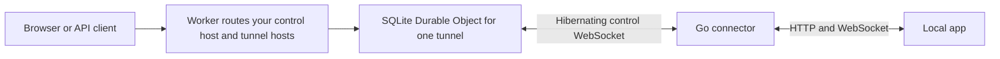

# TunnelWorker

TunnelWorker exposes a local HTTP application through Cloudflare Workers and one SQLite-backed Durable Object per tunnel. HTTP bodies are capped and sent in bounded frames; responses stream back with per-chunk acknowledgements. WebSocket traffic supports arbitrary application paths, including HMR endpoints.

The operator creates tunnels with a separate secret. Each tunnel gets a random URL ID and a one-time connector credential. A tunnel expires after 30 minutes by default (minimum 1 minute, maximum 24 hours). Reconnecting uses the same credentials and keeps the original expiry. An optional visitor password protects HTTP and browser WebSocket requests; without one, the tunnel is public.



## Run locally

Requirements: Node.js 22+, Go 1.25.4+, and Python 3.12 only for the black-box smoke script.

```sh
npm ci
cp .dev.vars.example .dev.vars
# Replace the placeholder OPERATOR_TOKEN in .dev.vars with a long random value.
npm run dev
```

Local development and Vitest use `wrangler.local.jsonc` with the reserved `example.test` hostname and no production routes. For a local end-to-end tunnel, set the virtual host in the request:

```sh
export TUNNELWORKER_TOKEN='the-same-local-operator-token'
go run ./cmd/tunnelworker --url http://127.0.0.1:8787 --port 3000 --ttl 30m
curl -H 'Host: <id>-tunnel.example.test' http://127.0.0.1:8787/health
```

The CLI requires the Worker endpoint through `--url` or `TUNNELWORKER_URL`; it has no baked-in service endpoint. `--url` selects the Worker endpoint and `--domain` overrides the host used for routing when that differs from the endpoint hostname. Loopback endpoints use `example.test` as the local routing host. For custom local routes, set `--domain` explicitly.

The CLI prints the public URL and expiry, then runs until interrupted. It saves the reconnect credential in a mode `0600` session file under the operating system's user config directory. Resume a tunnel after a connector restart with:

```sh
go run ./cmd/tunnelworker --url http://127.0.0.1:8787 --port 3000 --connect TUNNEL_ID
```

The CLI reads the matching saved credential automatically. To use a custom file or pass the credential explicitly, use `--session-file PATH` and `--token CREDENTIAL`. A newly created tunnel can be visitor-password protected with `--password VALUE` or `TUNNELWORKER_PASSWORD`; the CLI does not put credentials in tunnel URLs or print them. A deliberate Ctrl+C revokes the tunnel and removes its session file. An unexpected connector exit leaves it available until its original expiry.

For local app servers with TLS or a non-default local address, use `--local https://127.0.0.1:3000`. HTTP(S)_PROXY and the system CA trust store are used for the Worker control connection; local origin traffic connects directly to the configured local URL.

## Deploy with your domain

This repository does not include a Deploy button or a default production domain. Choose a control hostname and a public parent domain that you control, configure DNS, TLS, and Worker routes, then deploy. The checked-in `wrangler.jsonc` intentionally has no routes and empty `BASE_DOMAIN` and `VISITOR_DOMAIN` vars; both must be configured before deployment.

For example, if you control `example.net`, use `tunnel.example.net` for the control API and `<id>-tunnel.example.net` for visitor URLs. Edit `wrangler.jsonc` before deploying:

```jsonc
"routes": [
  { "pattern": "tunnel.example.net/*", "zone_name": "example.net" },
  { "pattern": "*-tunnel.example.net/*", "zone_name": "example.net" },
],
"vars": {
  "BASE_DOMAIN": "tunnel.example.net",
  "VISITOR_DOMAIN": "example.net",
  // Keep the other checked-in TTL and body-size settings.
}
```

Replace the sample names with the matching control hostname and public parent domain for your setup. In Cloudflare DNS, add a proxied A record for the control host and a proxied `*` A record in the public parent zone, both pointing to `192.0.2.0` (the documentation-only placeholder; the Worker handles matched requests and there is no origin server). The `*` DNS record makes otherwise-unconfigured first-level subdomains resolve through Cloudflare; use per-tunnel DNS records instead if that broad DNS behavior is unsuitable. The Worker Route `*-tunnel.example.net/*` filters which of those hosts invoke this Worker. Verify that the active edge certificate covers `*.example.net`; this first-level wildcard is within normal Universal SSL coverage. The route-free configuration disables `workers.dev`; deployment requires the custom domain routes you add. This project does not modify DNS or Cloudflare settings for you.

Then install dependencies, set the operator secret, and deploy:

```sh
npm ci
npx wrangler secret put OPERATOR_TOKEN
npm run deploy
```

The configured control host is used by the CLI, for example `go run ./cmd/tunnelworker --url https://tunnel.example.net --port 3000`. The Worker returns visitor URLs in the `<id>-tunnel.example.net` form. You can use a different control routing host with `--domain`. Never commit operator or connector credentials.

## Protocol and limits

- `POST https://<control-host>/api/tunnels` uses `Authorization: Bearer <operator token>` and JSON `{ "ttlSeconds": 1800, "visitorPassword": "optional password" }`. The response returns the tunnel ID, visitor URL, one-time connector credential, and absolute expiry.
- The control WebSocket endpoint is `wss://<control-host>/api/tunnels/<id>/connect` with the per-tunnel Bearer credential. Production uses the URL hostname as HTTP `Host` and routes by path; the Worker validates the ID and rewrites the internal DO request to `/_control`. Loopback Wrangler runs use the local `example.test` virtual host for compatibility. The Durable Object accepts the WebSocket with hibernation and stores its role in a serialized attachment.
- `DELETE https://<control-host>/api/tunnels/<id>` uses `Authorization: Bearer <connector token>` to revoke the tunnel. Creating a tunnel still uses the separate operator token.
- The public URL uses `https://<id>-tunnel.<public-domain>`. The Worker validates the 36-character lowercase hex ID encoded in the hostname and loads that tunnel's Durable Object. It does not accept the old `<id>.<control-host>` visitor hostname.
- Other HTTP requests and WebSocket upgrades on the tunnel host route to the local app. `/_control` is reserved. Visitor WebSockets can use app paths such as `/_next/webpack-hmr` or `/socket.io/`.
- When a visitor password is configured, HTTP requests require HTTP Basic authentication or `X-Tunnel-Password`. Successful HTTP authentication sets an expiring, HttpOnly, Secure, SameSite=Lax cookie; browsers send that cookie on subsequent WebSocket handshakes. Passwords are never accepted in URL query parameters. The relay cookie is removed before forwarding app cookies to the local origin.
- A failed connector returns 503. The connector retries transient control connection failures with backoff while the tunnel has not expired. Expiry is absolute, checked on requests and socket messages, and enforced by an alarm.
- Request and response bodies are limited to 8 MiB by default. HTTP requests are accumulated in a bounded buffer before their 36 KiB protocol frames are sent. HTTP responses stream in chunks up to 32 KiB; the connector waits for the browser stream to consume each chunk before sending more. Per-tunnel HTTP concurrency is capped at four; visitor WebSockets are capped at 64.
- Control WebSocket JSON frames use `http`, `http_body`, `http_body_end`, `http_start`, `http_chunk`, `http_ack`, `http_end`, `http_cancel`, `ws_open`, `ws_opened`, `ws_message`, `ws_close`, and `ws_error`. Binary payloads are base64 encoded. Connector messages are size checked and credentials do not appear in protocol URLs.
- The Go connector honors HTTP(S)_PROXY for Worker API/control connections and uses Go's system certificate roots. Local app requests bypass the proxy to avoid sending local traffic through an external proxy.

The platform and your local app can impose lower body, duration, or connection limits. Request bodies are bounded but buffered; response bodies stream. Long idle responses are canceled after 60 seconds. WebSocket messages are capped by the control-frame limit. A tunnel is a development preview, not an internet-facing application gateway: apply your app's own authorization and rate limits before sharing it.

## Validation

```sh
npm run types
npm run typecheck
npm test
go test -race ./...
go vet ./...
python -m pip install -r requirements-smoke.txt
python scripts/smoke.py --skip-expiry
npx wrangler deploy --dry-run --outdir=/tmp/tunnelworker-dry-run
```

The Vitest suite runs inside workerd with SQLite Durable Objects. The Python smoke test starts local Wrangler, a local HTTP/WebSocket origin, and the actual Go connector. It does not deploy or contact a Cloudflare account. It can also test TTL and reconnect behavior without `--skip-expiry`, which waits at least one minute.

## References

- [Durable Object WebSocket hibernation](https://developers.cloudflare.com/durable-objects/best-practices/websockets/)
- [Cloudflare Workers Vitest integration](https://developers.cloudflare.com/workers/testing/vitest-integration/)
- [Cloudflare Wrangler routes](https://developers.cloudflare.com/workers/configuration/routing/routes/)
- [Cloudflare Universal SSL coverage](https://developers.cloudflare.com/ssl/edge-certificates/universal-ssl/)
