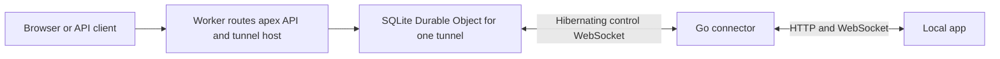

# TunnelWorker

TunnelWorker exposes a local HTTP application through Cloudflare Workers and one SQLite-backed Durable Object per tunnel. HTTP bodies are capped and sent in bounded frames; responses stream back with per-chunk acknowledgements. WebSocket traffic supports arbitrary application paths, including HMR endpoints.

The operator creates tunnels with a separate secret. Each tunnel gets a random URL ID and a one-time connector credential. A tunnel expires after 30 minutes by default (minimum 1 minute, maximum 24 hours). Reconnecting uses the same credentials and keeps the original expiry.



## Run locally

Requirements: Node.js 22+, Go 1.25.4+, and Python 3.12 only for the black-box smoke script.

```sh
npm ci
cp .dev.vars.example .dev.vars
# Replace the placeholder OPERATOR_TOKEN in .dev.vars with a long random value.
npm run dev
```

Local dev and Vitest use `wrangler.local.jsonc`, which omits the production route table so Wrangler preserves the virtual tunnel host in local requests. Deployment uses `wrangler.jsonc` with the `dev.example.net/*` and `*.dev.example.net/*` routes.

Deployment requires a custom domain with DNS and Worker routes configured for both the control apex and tunnel subdomains. Cloudflare's default `workers.dev` hostname is disabled and cannot create tunnels or carry tunnel traffic. Set `BASE_DOMAIN` to the routed custom domain if you use a different one.

In another terminal, start a local app and connect the CLI:

```sh
export TUNNELWORKER_TOKEN='the-same-local-operator-token'
go run ./cmd/tunnelworker --url http://127.0.0.1:8787 --port 3000 --ttl 30m
```

The CLI prints the public URL and expiry, then runs until interrupted. It saves the reconnect credential in a mode `0600` session file under the operating system's user config directory. Resume a tunnel after a connector restart with:

```sh
go run ./cmd/tunnelworker --url http://127.0.0.1:8787 --port 3000 --connect TUNNEL_ID
```

The CLI reads the matching saved credential automatically. To use a custom file or pass the credential explicitly, use `--session-file PATH` and `--token CREDENTIAL`. A newly created tunnel can be visitor-password protected with `--password VALUE` or `TUNNELWORKER_PASSWORD`; the CLI does not put credentials in tunnel URLs or print them. A deliberate Ctrl+C revokes the tunnel and removes its session file. An unexpected connector exit leaves it available until its original expiry.

The printed public URL is reachable once DNS and Worker routes are deployed. During local development, send requests to Wrangler's loopback address and set the public host explicitly:

```sh
curl -H 'Host: <id>.dev.example.net' http://127.0.0.1:8787/health
```

For local app servers with TLS or a non-default local address, use `--local https://127.0.0.1:3000`. HTTP(S)_PROXY and the system CA trust store are used for the Worker control connection; local origin traffic connects directly to the configured local URL. `--url` selects the Worker endpoint; `--domain` can override the route domain when the Worker endpoint host differs from the public tunnel domain.

## Deploy to Cloudflare

1. Add `example.net` to Cloudflare and make sure its zone is active.
2. Add proxied, originless DNS `A` records for `dev` and `*.dev` using `192.0.2.0` as the placeholder. Proxied requests are intercepted by Cloudflare before they reach that address, and the Worker routes handle them. Cloudflare requires a proxied DNS record for each routed hostname.
3. Provide TLS certificate coverage for both `dev.example.net` and `*.dev.example.net`. Cloudflare Universal SSL on a full zone covers the apex and one subdomain level; it does **not** cover `*.dev.example.net`. Order an Advanced Certificate with the explicit `*.dev.example.net` hostname, or upload a custom certificate with that wildcard SAN. If using automatic certificate issuance, verify that the resulting certificate covers the nested wildcard before directing users to it.
4. Install dependencies, review `wrangler.jsonc`, then set the operator secret and deploy:

   ```sh
   npm ci
   npx wrangler secret put OPERATOR_TOKEN
   npm run deploy
   ```

The Wrangler routes in the config cover the control apex (`dev.example.net/*`) and tunnel hosts (`*.dev.example.net/*`) in the `example.net` zone. No account or DNS changes are made by this repository's tests. The production secret must be set with Wrangler or Cloudflare's dashboard; do not add its value to the config or source.

## 简要说明

本工具把本机 HTTP/WebSocket 服务通过 Cloudflare Worker 暴露出来。默认有效期为 30 分钟，最多 24 小时；重连不会延长原到期时间。访客密码同时保护 HTTP 和浏览器 WebSocket：先通过 HTTP Basic 验证后会得到短期、安全的 Cookie，HMR WebSocket 会自动携带该 Cookie。`dev.example.net` 和 `*.dev.example.net` 都需要 Cloudflare DNS/Worker 路由；请为 `*.dev.example.net` 单独配置 TLS 覆盖范围，普通 Universal SSL 不覆盖这个多级通配符。

## Protocol and limits

- `POST https://dev.example.net/api/tunnels` uses `Authorization: Bearer <operator token>` and JSON `{ "ttlSeconds": 1800, "visitorPassword": "optional password" }`. The response returns the tunnel ID, visitor URL, one-time connector credential, and absolute expiry.
- The logical control endpoint is `wss://<id>.dev.example.net/_control` with its per-tunnel Bearer credential. The Go CLI dials the configured Worker `--url` hostname (for example `dev.example.net`) and sets the HTTP `Host` header to `<id>.dev.example.net`; this lets the control connection use the base endpoint with HTTP(S)_PROXY while still selecting the tunnel Durable Object. The Durable Object accepts the WebSocket with hibernation and stores its role in a serialized attachment.
- Other HTTP requests and WebSocket upgrades on the tunnel host route to the local app. `/_control` is reserved. Visitor WebSockets can use app paths such as `/_next/webpack-hmr` or `/socket.io/`.
- When a visitor password is configured, HTTP requests require HTTP Basic authentication or `X-Tunnel-Password`. Successful HTTP authentication sets an expiring, HttpOnly, Secure, SameSite=Lax cookie; browsers send that cookie on subsequent WebSocket handshakes. Passwords are never accepted in URL query parameters. The relay cookie is removed before forwarding app cookies to the local origin.
- A failed connector returns 503. The connector retries transient control connection failures with backoff while the tunnel has not expired. Expiry is absolute, checked on requests and socket messages, and enforced by an alarm.
- Request bodies and response bodies are limited to 8 MiB by default (configurable up to 8 MiB in this build). HTTP requests are accumulated in a bounded buffer before their 36 KiB protocol frames are sent. HTTP responses stream in chunks up to 32 KiB; the connector waits for the browser stream to consume each chunk before sending more. Per-tunnel HTTP concurrency is capped at four; visitor WebSockets are capped at 64.
- Control WebSocket JSON frames use `http`, `http_body`, `http_body_end`, `http_start`, `http_chunk`, `http_ack`, `http_end`, `http_cancel`, `ws_open`, `ws_opened`, `ws_message`, `ws_close`, and `ws_error`. Binary payloads are base64 encoded. Connector messages are size checked and credentials do not appear in protocol URLs.
- The Go connector honors HTTP(S)_PROXY for Worker API/control connections and uses Go's system certificate roots. Local app requests bypass the proxy to avoid sending local traffic through an external proxy.

The platform and your local app can impose lower body, duration, or connection limits. Request bodies are bounded but buffered; response bodies stream. Long idle responses are canceled after 60 seconds. WebSocket messages are capped by the control-frame limit. A tunnel is a development preview, not an internet-facing application gateway: apply your app's own authorization and rate limits before sharing it.

## Validation

```sh
npm run types
npm run typecheck
npm test
go test -race ./...
go vet ./...
python -m pip install -r requirements-smoke.txt
python scripts/smoke.py --skip-expiry
npx wrangler deploy --dry-run --outdir=/tmp/tunnelworker-dry-run
```

The Vitest suite runs inside workerd with SQLite Durable Objects. The Python smoke test starts local Wrangler, a local HTTP/WebSocket origin, and the actual Go connector. It does not deploy or contact a Cloudflare account. It can also test TTL and reconnect behavior without `--skip-expiry`, which waits at least one minute.

## References

- [Durable Object WebSocket hibernation](https://developers.cloudflare.com/durable-objects/best-practices/websockets/)
- [Cloudflare Workers Vitest integration](https://developers.cloudflare.com/workers/testing/vitest-integration/)
- [Cloudflare Wrangler routes](https://developers.cloudflare.com/workers/configuration/routing/routes/)
- [Cloudflare Universal SSL coverage](https://developers.cloudflare.com/ssl/edge-certificates/universal-ssl/)
