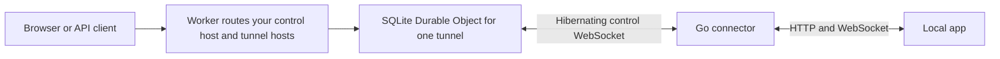

# TunnelWorker

TunnelWorker exposes a local HTTP application through Cloudflare Workers and one SQLite-backed Durable Object per tunnel. HTTP bodies are capped and sent in bounded frames; responses stream back with per-chunk acknowledgements. WebSocket traffic supports arbitrary application paths, including HMR endpoints.

The operator creates tunnels with a separate secret. Each tunnel gets a random URL ID and a one-time connector credential. A tunnel expires after 30 minutes by default (minimum 1 minute, maximum 24 hours). Reconnecting uses the same credentials and keeps the original expiry. An optional visitor password protects HTTP and browser WebSocket requests; without one, the tunnel is public.

The current project is self-hosted: each operator deploys their own Worker and configures their own domain and secret. Making this repository public will let others deploy their own instance; it does not create a shared public tunnel service.



## Install the connector

After a public release is published, download the archive for your OS and architecture from GitHub Releases, extract `tunnelworker`, and run `tunnelworker --version`. With the repository public and Go installed, you can also install from source:

```sh
go install github.com/tanwaikin/TunnelWorker/cmd/tunnelworker@latest
```

The Connector is a Go program; publishing the Worker on npm is not required. The Worker itself is deployed separately with Wrangler as described below.

## Run locally

Requirements: Node.js 22+, Go 1.25.4+, and Python 3.12 only for the black-box smoke script.

```sh
npm ci
cp .dev.vars.example .dev.vars
# Replace the placeholder OPERATOR_TOKEN in .dev.vars with a long random value.
npm run dev
```

Local development and Vitest use `wrangler.local.jsonc` with the reserved `example.test` hostname and no production routes. For a local end-to-end tunnel, set the virtual host in the request:

```sh
export TUNNELWORKER_TOKEN='the same value as OPERATOR_TOKEN in .dev.vars'
go run ./cmd/tunnelworker --url http://127.0.0.1:8787 --port 3000 --ttl 30m
curl -H 'Host: <id>-tunnel.example.test' http://127.0.0.1:8787/health
```

The CLI requires the Worker endpoint through `--url` or `TUNNELWORKER_URL`; it has no baked-in service endpoint. `--url` selects the Worker endpoint and `--domain` overrides the host used for routing when that differs from the endpoint hostname. Loopback endpoints use `example.test` as the local routing host. For custom local routes, set `--domain` explicitly.

The CLI prints the public URL and expiry, then runs until interrupted. It saves the reconnect credential in a mode `0600` session file under the operating system's user config directory. Resume a tunnel after a connector restart with:

```sh
go run ./cmd/tunnelworker --url http://127.0.0.1:8787 --port 3000 --connect TUNNEL_ID
```

The CLI reads the matching saved credential automatically. To use a custom file or pass the credential explicitly, use `--session-file PATH` and `--token CREDENTIAL`. A newly created tunnel can be visitor-password protected with `--password VALUE` or `TUNNELWORKER_PASSWORD`; the CLI does not put credentials in tunnel URLs or print them. A deliberate Ctrl+C revokes the tunnel and removes its session file. An unexpected connector exit leaves it available until its original expiry. DNS records are managed separately: Ctrl+C does not remove the visitor DNS record.

For local app servers with TLS or a non-default local address, use `--local https://127.0.0.1:3000`. HTTP(S)_PROXY and the system CA trust store are used for the Worker control connection; local origin traffic connects directly to the configured local URL.

## Deploy to Cloudflare

[](https://deploy.workers.cloudflare.com/?url=https://github.com/tanwaikin/TunnelWorker)

The button will be usable by everyone once this GitHub repository is public; Cloudflare does not accept private repositories for Deploy Buttons. It copies the project into your GitHub account, provisions the Durable Object binding, and connects Workers Builds so later pushes to your production branch deploy automatically. This creates your own self-hosted instance; it is not a shared TunnelWorker service. See [Cloudflare Deploy Buttons](https://developers.cloudflare.com/workers/platform/deploy-buttons/) for their current flow and limitations.

The template intentionally has no default domain routes, has `workers_dev` disabled, and leaves `BASE_DOMAIN` and `VISITOR_DOMAIN` empty. The Deploy Button can collect the configured environment variables and `OPERATOR_TOKEN` secret, but it cannot choose a domain or create your DNS records. The Worker will not accept public traffic until you configure your own zone, routes, and DNS as below.

### 1. Configure your domain and routes

Use a Cloudflare zone you control. For example, if your zone is `example.net`, use `tunnel.example.net` for the control API and `<id>-tunnel.example.net` for visitor URLs. Add or replace these top-level keys in the copied repository's `wrangler.jsonc` (merge them with the existing settings):

```jsonc
{
  "routes": [
    { "pattern": "tunnel.example.net/*", "zone_name": "example.net" },
    { "pattern": "*-tunnel.example.net/*", "zone_name": "example.net" },
  ],
  "vars": {
    "BASE_DOMAIN": "tunnel.example.net",
    "VISITOR_DOMAIN": "example.net",
    // Keep the other checked-in TTL and body-size settings.
  },
}
```

Replace the sample host and zone with yours. In the Deploy Button form, if prompted, enter the same `BASE_DOMAIN` and `VISITOR_DOMAIN` values and generate a long random `OPERATOR_TOKEN`. If you configure the secret later, use `npx wrangler secret put OPERATOR_TOKEN` from the copied repository; never commit it.

### 2. Add proxied DNS records and verify TLS

Create a proxied A record for the control hostname, such as `tunnel`, pointing to `192.0.2.0` (a documentation-only placeholder; matching requests are handled by the Worker and there is no origin server). After creating each tunnel, add an exact proxied A record named `<id>-tunnel` in the parent zone, also pointing to `192.0.2.0`. The CLI does not create or delete DNS records, so remove the exact record yourself when you no longer need it. This setup leaves other subdomains alone.

A broad `*` DNS record is optional. It makes otherwise-unconfigured first-level subdomains resolve through Cloudflare; only names matching `*-tunnel.example.net/*` invoke this Worker. Verify the active edge certificate covers `*.example.net`. The checked-in config keeps `workers_dev` disabled, so the custom routes are required. This project does not change your DNS, zone, or certificate settings.

### 3. Deploy the configured Worker

If you used the Deploy Button, commit the domain and route changes to the copied repository; Workers Builds will deploy the update. For a manual Wrangler deploy instead:

```sh
npm ci
npx wrangler secret put OPERATOR_TOKEN
npm run deploy
```

### 4. Connect your local app

Install the Connector from GitHub Releases after a public release is available, or build it from the public source:

```sh
go install github.com/tanwaikin/TunnelWorker/cmd/tunnelworker@latest
```

Start your local HTTP app, then set `TUNNELWORKER_TOKEN` to the same operator secret configured on the Worker and run:

```sh
export TUNNELWORKER_TOKEN='<your OPERATOR_TOKEN>'
tunnelworker --url https://tunnel.example.net --local http://127.0.0.1:3000 --ttl 30m
```

The CLI prints the visitor URL and expiry and keeps the tunnel connected. Add the exact visitor DNS record for its printed ID, then open the HTTPS URL. To protect it with a password, add `--password '<visitor-password>'`. Pressing Ctrl+C revokes the tunnel and removes its local session file; delete its DNS record separately. Never commit operator or connector credentials.

## Protocol and limits

- `POST https://<control-host>/api/tunnels` uses `Authorization: Bearer <operator token>` and JSON `{ "ttlSeconds": 1800, "visitorPassword": "optional password" }`. The response returns the tunnel ID, visitor URL, one-time connector credential, and absolute expiry.
- The control WebSocket endpoint is `wss://<control-host>/api/tunnels/<id>/connect` with the per-tunnel Bearer credential. Production uses the URL hostname as HTTP `Host` and routes by path; the Worker validates the ID and rewrites the internal DO request to `/_control`. Loopback Wrangler runs use the local `example.test` virtual host for compatibility. The Durable Object accepts the WebSocket with hibernation and stores its role in a serialized attachment.
- `DELETE https://<control-host>/api/tunnels/<id>` uses `Authorization: Bearer <connector token>` to revoke the tunnel. Creating a tunnel still uses the separate operator token.
- The public URL uses `https://<id>-tunnel.<public-domain>`. The Worker validates the 36-character lowercase hex ID encoded in the hostname and loads that tunnel's Durable Object. It does not accept the old `<id>.<control-host>` visitor hostname.
- Other HTTP requests and WebSocket upgrades on the tunnel host route to the local app. `/_control` is reserved. Visitor WebSockets can use app paths such as `/_next/webpack-hmr` or `/socket.io/`.
- When a visitor password is configured, HTTP requests require HTTP Basic authentication or `X-Tunnel-Password`. Successful HTTP authentication sets an expiring, HttpOnly, Secure, SameSite=Lax cookie; browsers send that cookie on subsequent WebSocket handshakes. Passwords are never accepted in URL query parameters. The relay cookie is removed before forwarding app cookies to the local origin.
- A failed connector returns 503. The connector retries transient control connection failures with backoff while the tunnel has not expired. Expiry is absolute, checked on requests and socket messages, and enforced by an alarm.
- Request bodies are limited to 8 MiB by default and accumulated in a bounded buffer before their 36 KiB protocol frames are sent. HTTP responses have no cumulative relay size limit and stream in chunks up to 32 KiB; the connector waits for the browser stream to consume each chunk before sending more. Each tunnel forwards up to eight HTTP requests at a time and queues up to 32 more for at most 15 seconds; overflow or queue timeout returns 503 with `Retry-After: 1`. Visitor WebSockets are capped at 64.
- Control WebSocket JSON frames use `http`, `http_body`, `http_body_end`, `http_start`, `http_chunk`, `http_ack`, `http_end`, `http_cancel`, `ws_open`, `ws_opened`, `ws_message`, `ws_close`, and `ws_error`. Binary payloads are base64 encoded. Connector messages are size checked and credentials do not appear in protocol URLs.
- The Go connector honors HTTP(S)_PROXY for Worker API/control connections and uses Go's system certificate roots. Local app requests bypass the proxy to avoid sending local traffic through an external proxy.

The platform and your local app can impose lower body, duration, or connection limits. Request bodies are bounded but buffered; response bodies stream without a cumulative byte limit. Long idle responses are canceled after 60 seconds. WebSocket messages are capped by the control-frame limit. A tunnel is a development preview, not an internet-facing application gateway: apply your app's own authorization and rate limits before sharing it.

## Validation

```sh
npm run types
npm run typecheck
npm test
go test -race ./...
go vet ./...
python -m pip install -r requirements-smoke.txt
python scripts/smoke.py --skip-expiry
npx wrangler deploy --dry-run --outdir=/tmp/tunnelworker-dry-run
```

The Vitest suite runs inside workerd with SQLite Durable Objects. The Python smoke test starts local Wrangler, a local HTTP/WebSocket origin, and the actual Go connector. It does not deploy or contact a Cloudflare account. It can also test TTL and reconnect behavior without `--skip-expiry`, which waits at least one minute.

## Community

See [CONTRIBUTING.md](CONTRIBUTING.md) for the development workflow and [SECURITY.md](SECURITY.md) for vulnerability reporting. Private vulnerability reporting must be enabled in GitHub before the repository becomes public.

TunnelWorker is licensed under the [MIT License](LICENSE).

## References

- [Durable Object WebSocket hibernation](https://developers.cloudflare.com/durable-objects/best-practices/websockets/)
- [Cloudflare Workers Vitest integration](https://developers.cloudflare.com/workers/testing/vitest-integration/)
- [Cloudflare Wrangler routes](https://developers.cloudflare.com/workers/configuration/routing/routes/)
- [Cloudflare Universal SSL coverage](https://developers.cloudflare.com/ssl/edge-certificates/universal-ssl/)
